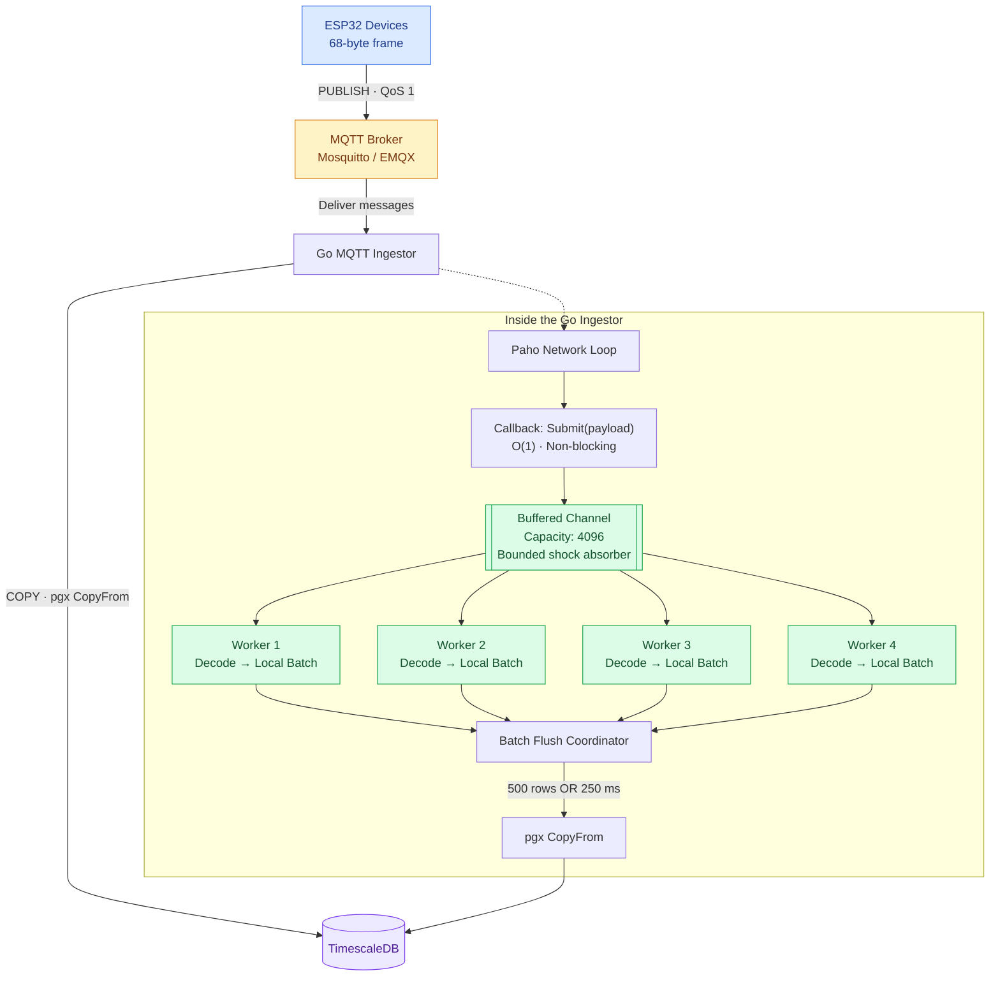

# MQTT INGESTER
This is a high throughput MQTT telemetry ingester written in Go. It subscribes to sensor topics, decodes a fixed binary frame, batches rows and writes them to Timescale DB with COPY.

The goal is to: Sustain atleast 100writes/s with large headroom (design goal 10x to 50x), never block MQTT network loop and fail in ways that are visible and recoverable.


## Contents
1. [Architecture](#architecture)
2. [Quick start](#quick-start)
3. [Configuration](#configuration)
4. [Wire format](#wire-format)
5. [Database schema](#database-schema)
6. [Benchmarking](#benchmarking)
7. [Operations and observability](#operations-and-observability)
8. [Failure behavior](#failure-behavior)
9. [Design decisions](#design-decisions)
10. [Tuning](#tuning)
11. [Troubleshooting](#troubleshooting)
12. [Roadmap](#roadmap)


## Architecture


Three stages run at very different speeds (network in microseconds, decode in nanoseconds, database in milliseconds with spikes). Each boundary exists so a slow stage cannot stall a fast one.

### Folder Structure

```
tsingest/
  cmd/ingestor/main.go       entrypoint: wiring, MQTT client, shutdown
  cmd/simulator/main.go      load generator
  internal/model/reading.go  Reading struct and binary codec
  internal/ingest/pipeline.go  channel, workers, batching, retry
  internal/store/writer.go   pgx CopyFrom writer
  db/init/001_schema.sql     schema, compression, retention, rollup
  mosquitto/mosquitto.conf   local broker config
  docker-compose.yml         local TimescaleDB + Mosquitto
  Makefile                   common commands
```

## Quick start

### Prerequisites

- Go 1.22 or newer (`go version`)
- Docker Engine with the Compose plugin (`docker compose version`)
  Installing Docker on Ubuntu or Debian:

```bash
curl -fsSL https://get.docker.com | sh
sudo usermod -aG docker $USER
newgrp docker
docker compose version
```

No local Postgres or TimescaleDB install is needed. Both run in containers.

### Run it

```bash
cp .env.example .env
make up         
go mod tidy     
make run        
make sim         
make rate        
```

The ingestor prints one stats line per second:

```
written/s=100 total=3000 recv=3000 dropped=0 failed=0 decodeErr=0 queue=0
```

### Reset everything

```bash
make reset       
make up         
```

The schema script only runs on an empty data volume, so after editing `db/init/001_schema.sql` you need `make reset`.

## Configuration

Environment variables, read from `.env` by the Makefile.

| Variable | Default | Purpose |
|---|---|---|
| `DATABASE_URL` | none (required) | pgx connection string |
| `MQTT_BROKER` | none (required) | Broker URL, for example `tcp://localhost:1883` |
| `MQTT_CLIENT_ID` | none (required) | Must be unique per replica |
| `MQTT_TOPIC` | `telemetry/+/data` | Subscription filter. Use `$share/ingest/telemetry/+/data` for replicas |

Pipeline settings (compiled in `cmd/ingestor/main.go`, candidates for env vars):

| Setting | Value | Meaning |
|---|---|---|
| Workers | 4 | Roughly the number of DB connections, not CPU cores |
| QueueSize | 4096 | About 40 s of buffering at 100 msg/s |
| BatchSize | 500 | Rows per COPY |
| FlushEvery | 250 ms | Upper bound on added latency when traffic is low |
| EnqueueWait | 5 ms | How long a callback waits on a full queue before dropping |

## Wire format

Fixed 68-byte little-endian frame, published to `telemetry/{device_id}/data` with QoS 1.

| Offset | Size | Field | Type |
|---|---|---|---|
| 0 | 4 | device_id | uint32 |
| 4 | 8 | timestamp (microseconds since epoch) | int64 |
| 12 | 4 | temperature | float32 |
| 16 | 4 | humidity | float32 |
| 20 | 12 | accelerometer x, y, z | 3 x float32 |
| 32 | 12 | gyroscope x, y, z | 3 x float32 |
| 44 | 8 | latitude | float64 |
| 52 | 8 | longitude | float64 |
| 60 | 4 | altitude | float32 |
| 64 | 4 | speed | float32 |

Latitude and longitude are float64 because float32 loses about a metre of precision. Frames with any other length are counted in `decodeErr` and skipped.

On the ESP32 side this maps to a packed C struct, so no serialization library is needed.

## Database schema
**Note on Database Choice:** While there are other databases purpose-built for time-series workloads, I chose TimescaleDB for this project because of my familiarity with PostgreSQL. TimescaleDB is a PostgreSQL extension that adds time-series capabilities while retaining the underlying PostgreSQL ecosystem. This allowed me to build on what I already knew while exploring time-series data ingestion.

TimescaleDB hypertable `telemetry`, chunked by day.

- One index: `(device_id, time DESC)`. The default time-only index is disabled to protect write throughput.
- Compression after 3 days, segmented by `device_id`.
- Retention of 90 days.
- Continuous aggregate `telemetry_1m` (1 minute rollup per device) for dashboards.
- The `ingestor` role runs with `synchronous_commit = off`.
  Compression and policy syntax differs slightly between Timescale versions (newer ones call it "columnstore"). The compose file pins `2.17.2-pg16` so the init script is known to work. Check the docs before upgrading.

## Benchmarking

The simulator runs N devices, each with its own MQTT connection, publishing at a fixed rate.

| Command | Load | Purpose |
|---|---|---|
| `make sim` | 100 msg/s | Meets the target |
| `make sim-1k` | 1,000 msg/s | Headroom check |
| `make sim-5k` | 5,000 msg/s | Find the first bottleneck |

### Pass criteria for the 100 msg/s target

- `written/s` sustained at 100 or more
- `dropped=0` and `failed=0` in the ingestor log
- Queue depth stays near 0
- p99 publish-to-PUBACK latency under about 50 ms in the simulator output
- Row count in the database matches the simulator's `sent` count (`make count`)

## Benchmark results

Environment: one Linux laptop (Arch) running the ingestor, the simulator, Mosquitto and TimescaleDB together, the last two in Docker. Config: 4 workers, batch 500, flush 250 ms, queue 4096, QoS 1. Everything shares one machine, so treat the numbers as relative, not absolute.

### Verified runs

| Target (msg/s) | Devices | Sent | Rows written | Achieved (msg/s) | Dropped | Failed | PUBACK p50 | p95 | p99 | max |
|---|---|---|---|---|---|---|---|---|---|---|
| 100 | 100 | 5,897 | 5,897 | 98.3 | 0 | 0 | 290 µs | 582 µs | 1.19 ms | 3.7 ms |
| 1,000 | 100 | 59,889 | 59,889 | 998.1 | 0 | 0 | 207 µs | 354 µs | 622 µs | 6.3 ms |
| 5,000 | 500 | 299,172 | 299,172 | 4,983.2 | 0 | 0 | 555 µs | 1.67 ms | 3.48 ms | 27.6 ms |
| 10,000 | 1,000 | 597,174 | 597,174 | 9,947.2 | 0 | 0 | 1.34 ms | 9.32 ms | 24.3 ms | 164 ms |

In every run, rows written in the database equaled messages sent, with no drops, no failed batches and no decode errors. The queue depth stayed at or near 0 (peak 20 at 5,000 msg/s).

### Invalid runs (not a result)

Attempts at 25k, 50k, 75k and 100k msg/s did not reach their targets. In each, exactly 1,016 clients connected and every other connection was refused, because the Mosquitto container hit its file-descriptor limit (its log shows "system socket count has been exceeded"). Those runs therefore only exercised about 1,016 devices at 10 Hz, which is why throughput plateaued near 10k msg/s. They say nothing about the ingestor's ceiling, so they are excluded from the table above.

### Takeaways

- The 100 msg/s target is met with about 100x headroom and no data loss across roughly 960k messages in the verified runs.
- Sustained throughput is verified up to about 10,000 msg/s, with the pipeline keeping up and the queue near empty.
- The ingestor's true ceiling is not yet measured. The limit found was the single-broker connection count in this local setup.
- Written/s moves in steps of 500 at high rates because rows are counted when each 500-row batch commits.

### Known limitations and next steps

- Raise Mosquitto's file-descriptor limit (`ulimits.nofile` in `docker-compose.yml`) and `max_connections` to test past 10k msg/s.
- Past roughly 28k connections from one machine, local ports run out. Use fewer connections that each publish for many virtual devices instead.
- Run the simulator on a separate machine from the broker and database for cleaner numbers.
- Profile the ingestor with pprof during a high-rate run to find the real bottleneck.