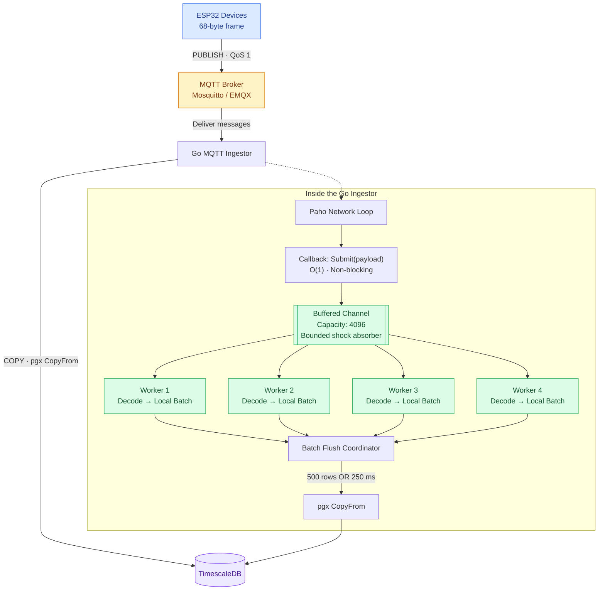

# MQTT INGESTER
This is a high throughput MQTT telemetry ingester written in Go. It subscribes to sensor topics, decodes a fixed binary frame, batches rows and writes them to Timescale DB with COPY.

The goal is to: Sustain atleast 100writes/s with large headroom (design goal 10x to 50x), never block MQTT network loop and fail in ways that are visible and recoverable.

**Result:** verified up to about 10,000 msg/s on a single laptop (including the broker and database on the same machine) with zero drops, zero failed batches and zero lost rows. See [Benchmark results](#benchmark-results) for exactly what was and was not measured.

## Contents
1. [Architecture](#architecture)
2. [Quick start](#quick-start)
3. [Configuration](#configuration)
4. [Wire format](#wire-format)
5. [Database schema](#database-schema)
6. [Benchmarking](#benchmarking)
7. [Operations and observability](#operations-and-observability)


## Architecture


Three stages run at very different speeds (network in microseconds, decode in nanoseconds, database in milliseconds with spikes). Each boundary exists so a slow stage cannot stall a fast one.

### Folder Structure

```
tsingest/
  cmd/ingestor/main.go       entrypoint: wiring, MQTT client, shutdown
  cmd/simulator/main.go      load generator
  internal/model/reading.go  Reading struct and binary codec
  internal/ingest/pipeline.go  channel, workers, batching, retry
  internal/store/writer.go   pgx CopyFrom writer
  db/init/001_schema.sql     schema, compression, retention, rollup
  mosquitto/mosquitto.conf   local broker config
  docker-compose.yml         local TimescaleDB + Mosquitto
  Makefile                   common commands
```
## Quick start

### Prerequisites

- Go 1.22 or newer (`go version`)
- Docker Engine with the Compose plugin (`docker compose version`)
  No local Postgres or TimescaleDB install is needed. Both run in containers.

### Run it

```bash
cp .env.example .env
make up          # starts TimescaleDB + Mosquitto, waits until healthy
go mod tidy      # first time only
make run         # terminal 1: the ingestor
make sim         # terminal 2: 100 msg/s for 60 s
make rate        # verify rows landed
```

The ingestor prints one stats line per second:

```
written/s=100 total=3000 recv=3000 dropped=0 failed=0 decodeErr=0 queue=0
```

### Reset everything

```bash
make reset       # removes containers and data volumes
make up          # fresh schema
```

The schema script only runs on an empty data volume, so after editing `db/init/001_schema.sql` you need `make reset`.

### Make targets

| Target | What it does |
|---|---|
| `make up` / `down` / `reset` | Start, stop, or wipe the local stack |
| `make logs` / `psql` | Follow container logs, open a SQL shell |
| `make run` | Run the ingestor |
| `make sim`, `sim-1k`, `sim-5k`, `sim-10k` | Load tests at 100, 1,000, 5,000 and 10,000 msg/s |
| `make count` / `rate` | Row count and rows/s from the database |
| `make test` / `bench` | Unit tests with the race detector, decoder benchmark |
| `make profile` | 30 s CPU profile of the running ingestor |

The `sim-25k` and larger targets need a higher broker connection limit, see [Known limitations](#known-limitations).

## Configuration

Environment variables, read from `.env` by the Makefile.

| Variable | Default | Purpose |
|---|---|---|
| `DATABASE_URL` | none (required) | pgx connection string |
| `MQTT_BROKER` | none (required) | Broker URL, for example `tcp://localhost:1883` |
| `MQTT_CLIENT_ID` | none (required) | Must be unique per replica |
| `MQTT_TOPIC` | `telemetry/+/data` | Subscription filter. Use `$share/ingest/telemetry/+/data` for replicas on a broker that supports shared subscriptions |

Pipeline settings (compiled into `cmd/ingestor/main.go`):

| Setting | Value | Meaning |
|---|---|---|
| Workers | 4 | Roughly the number of DB connections, not CPU cores |
| QueueSize | 4096 | About 40 s of buffering at 100 msg/s |
| BatchSize | 500 | Rows per COPY |
| FlushEvery | 250 ms | Upper bound on added latency when traffic is low |
| EnqueueWait | 5 ms | How long a callback waits on a full queue before dropping |

`.env` holds local credentials and must not be committed. Only `.env.example` is tracked.

## Endpoints

| Address | Purpose |
|---|---|
| `:9090/metrics` | Prometheus metrics |
| `:9090/healthz` | 200 when the MQTT connection is open and the database answers a ping, otherwise 503 |
| `localhost:6060/debug/pprof/` | Go profiling. Bound to localhost only, never expose it publicly |

Health check behavior was verified by stopping the TimescaleDB container: `/healthz` returned 503 with `db unreachable`, then returned to 200 after the container restarted, with no ingestor restart.

## Wire format

Fixed 68-byte little-endian frame, published to `telemetry/{device_id}/data` with QoS 1.

| Offset | Size | Field | Type |
|---|---|---|---|
| 0 | 4 | device_id | uint32 |
| 4 | 8 | timestamp (microseconds since epoch) | int64 |
| 12 | 4 | temperature | float32 |
| 16 | 4 | humidity | float32 |
| 20 | 12 | accelerometer x, y, z | 3 x float32 |
| 32 | 12 | gyroscope x, y, z | 3 x float32 |
| 44 | 8 | latitude | float64 |
| 52 | 8 | longitude | float64 |
| 60 | 4 | altitude | float32 |
| 64 | 4 | speed | float32 |

Latitude and longitude are float64 because float32 loses about a metre of precision. Frames with any other length are counted in `decodeErr` and skipped.

On the ESP32 side this maps to a packed C struct, so no serialization library is needed.

## Database schema

TimescaleDB hypertable `telemetry`, chunked by day.

- One index: `(device_id, time DESC)`. The default time-only index is disabled to protect write throughput.
- Compression after 3 days, segmented by `device_id`.
- Retention of 90 days.
- Continuous aggregate `telemetry_1m` (1 minute rollup per device) for dashboards.
- The `ingestor` role runs with `synchronous_commit = off`.
  Compression and policy syntax differs slightly between Timescale versions (newer ones call it "columnstore"). The compose file pins `2.17.2-pg16` so the init script is known to work. Check the docs before upgrading.

## Testing

```bash
make test     # go test ./... -race
make bench    # decoder benchmark
```

`reading_test.go` covers an encode/decode round trip and the bad-size error, and holds the decoder benchmark.

### Decoder benchmark

Intel i7-10610U, Go, linux/amd64:

| Benchmark | Time | Bytes/op | Allocs/op |
|---|---|---|---|
| Decode (68-byte frame) | 6.4 ns | 0 | 0 |

Decoding costs about 6 ns per message. At any rate this system will see, the decoder is effectively free.

The pipeline package (`internal/ingest`) does not have tests yet, see [Known limitations](#known-limitations).

## Benchmark results

**Environment:** one Linux laptop (Intel i7-10610U, about 15 GB RAM, Arch Linux) running the ingestor, the simulator, Mosquitto and TimescaleDB together, the last two in Docker. Config: 4 workers, batch 500, flush 250 ms, queue 4096, QoS 1. Everything shares one machine, so treat the numbers as relative, not absolute.

**Method:** the simulator opens one MQTT connection per device and publishes at a fixed rate for 60 s. After each run, the ingestor's written count was compared with the simulator's sent count.

### Verified runs

| Target (msg/s) | Devices | Sent | Rows written | Achieved (msg/s) | Dropped | Failed | PUBACK p50 | p95 | p99 | max |
|---|---|---|---|---|---|---|---|---|---|---|
| 100 | 100 | 5,897 | 5,897 | 98.3 | 0 | 0 | 290 us | 582 us | 1.19 ms | 3.7 ms |
| 1,000 | 100 | 59,889 | 59,889 | 998.1 | 0 | 0 | 207 us | 354 us | 622 us | 6.3 ms |
| 5,000 | 500 | 299,172 | 299,172 | 4,983.2 | 0 | 0 | 555 us | 1.67 ms | 3.48 ms | 27.6 ms |
| 10,000 | 1,000 | 597,174 | 597,174 | 9,947.2 | 0 | 0 | 1.34 ms | 9.32 ms | 24.3 ms | 164 ms |

In every run, rows written equaled messages sent, with no drops, no failed batches and no decode errors. Queue depth stayed at or near 0 (peak of 20 at 5,000 msg/s). Repeat 5,000 msg/s runs gave consistent results (for example 299,305 sent, 0 failures, p99 3.7 ms).

### Invalid runs (not a result)

Attempts at 25k, 50k, 75k and 100k msg/s did not reach their targets. In each, exactly 1,016 clients connected and every other connection was refused, because the Mosquitto container hit its file-descriptor limit (its log reports "system socket count has been exceeded"). Those runs only exercised about 1,016 devices at 10 Hz, which is why throughput plateaued near 10k msg/s. They say nothing about the ingestor's ceiling, so they are excluded from the table above.

### Resource usage at 5,000 msg/s

Single `docker stats` snapshot taken during a run (percent of one core, not averaged):

| Component | CPU | Memory |
|---|---|---|
| Mosquitto | about 17% | 5.6 MiB |
| TimescaleDB | about 7% | 91 MiB |

Neither the broker nor the database was close to saturation at this rate.

### Takeaways

- The 100 msg/s target is met with about 100x headroom and no data loss.
- Sustained throughput is verified up to about 10,000 msg/s with the pipeline keeping up and the queue near empty.
- The ingestor's true ceiling is not yet measured. The limit found was the single-broker connection count in this local setup.
- Written/s moves in steps of 500 at high rates because rows are counted when each 500-row batch commits.
## Profiling

Profiles were taken with `net/http/pprof` during a 5,000 msg/s run.

```bash
make run                  # terminal 1
make sim-5k               # terminal 2
make profile              # terminal 3, 30 s CPU profile with a web UI
go tool pprof -http=:8082 http://localhost:6060/debug/pprof/allocs
```

**CPU.** About a quarter of samples are idle scheduler time (threads waiting for work). Most of the rest, roughly half of samples, is the MQTT client library: reading packets, sending PUBACKs and per-message QoS 1 bookkeeping. pgx COPY encoding is a few percent. The worker loop and the decoder are too small to appear.

**Allocations** (cumulative, about 540 MB over the process lifetime). pgx COPY value encoding is the largest source at about a third, followed by paho's per-message topic routing and acking. The decoder allocates nothing, which matches the benchmark.

**Live memory** stays around 2.6 MB. **Goroutines** stay fixed at 22: 4 workers parked waiting for work, plus paho's reader, writer and router goroutines and runtime helpers. No goroutine growth.

**Conclusion.** At this load the ingestor's own code is not the bottleneck. Network I/O and the MQTT library dominate, and the next optimization candidate would be the pgx value encoding (a hand-rolled binary COPY encoder), worth doing only if a higher-rate test shows the ingestor saturating.

Percentages are read from flame graph widths and are approximate. Use `go tool pprof -top` on a saved profile for exact figures.

## Operations and observability

Counters are logged once per second and exposed at `:9090/metrics`.

| Metric | Meaning | Alert when |
|---|---|---|
| `ingest_received_total` | Messages handed to the pipeline | Drops to 0 unexpectedly |
| `ingest_written_total` | Rows committed | Falls behind received |
| `ingest_dropped_total` | Messages shed because the queue was full | Greater than 0 |
| `ingest_failed_total` | Rows lost after retries were exhausted | Greater than 0 |
| `ingest_decode_errors_total` | Malformed frames skipped | Rising, suggests a firmware bug |
| `ingest_queue_depth` | Current channel depth | Sustained above 50% of capacity |
| `ingest_queue_capacity` | Channel capacity | Reference value |

Suggested Prometheus alert expressions:

| Condition | Expression |
|---|---|
| Any drops | `increase(ingest_dropped_total[5m]) > 0` |
| Any lost rows | `increase(ingest_failed_total[5m]) > 0` |
| Queue filling | `ingest_queue_depth / ingest_queue_capacity > 0.5` for 1m |
| Falling behind | `rate(ingest_received_total[1m]) - rate(ingest_written_total[1m]) > 50` |

To watch the counters live during a load test:

```bash
watch -n1 'curl -s localhost:9090/metrics | grep ^ingest_'
```

To check where the database is waiting under load:

```bash
docker compose exec -T timescaledb psql -U ingestor -d telemetry -At -c \
 "SELECT coalesce(wait_event,'running'), count(*) FROM pg_stat_activity WHERE state='active' AND pid <> pg_backend_pid() GROUP BY 1;"
```


### Written BY:
WENDIE
## License

See [LICENSE](LICENSE).